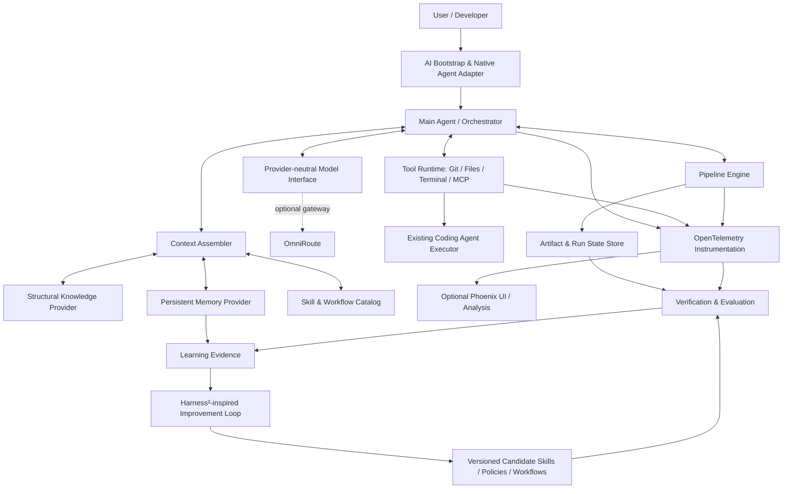

# 02 — Logical Architecture

## 1. Architecture at a glance

The harness is a modular system built around a **Master Agent** hosted by a supported executor. The Master is a delivery coordinator, not a substitute for the specialist agents organized across architecture, engineering, backlog management, and development. Versioned pipelines, contracts, tools, skills, project intelligence, memory, model access, verification, and learning support those real delegated agents.

## 2. Core components

### 2.1 Main Agent / Orchestrator

Responsibilities:

- Own the user's task and pipeline state.
- Decide which stage runs next.
- Ask clarifying questions when ambiguity changes scope, safety, or acceptance.
- Retrieve context through defined interfaces.
- Select skills and tools based on stage and project profile.
- Delegate to real specialist agents and coordinate their work; never simulate required specialists as personas in the master's execution.
- Enforce budgets, approval boundaries, and failure policies.
- Ensure artifacts are written and linked.
- Declare completion only after required gates pass.

The orchestrator is the logical Master Agent role and may run within a supported coding-agent executor. The executor must expose actual subagent/delegation capabilities; a separate daemon is not required by this design.

### 2.2 Pipeline Engine

Responsibilities:

- Load versioned pipeline definitions.
- Validate stage dependencies and contracts.
- Track run and stage state.
- Support end-to-end and direct stage invocation.
- Handle transitions, retries, pauses, resume, and cancellation.
- Prevent duplicate side effects on resume where feasible.

A pipeline is declarative configuration plus an execution protocol. Do not hard-code the entire workflow in one prompt.

### 2.3 Stage Executor

A stage is a bounded workflow with:

- ID and version.
- Purpose.
- Input contract.
- Preconditions.
- Procedure or skill references.
- Allowed tools and model profile.
- Output artifact contract.
- Validation rules.
- Failure and resume policy.

An executor can be `agent`, `deterministic-tool`, or `hybrid`. Stages do not map one-to-one to agents, but stages requiring specialist judgment invoke the appropriate real specialist. Verification combines deterministic checks and, where appropriate, independent QA/review agents.

### 2.4 Context Assembler

Builds a task-specific **Context Package** from:

- Task envelope and acceptance criteria.
- Relevant project profile and conventions.
- Scoped structural graph queries.
- Relevant memory pages and handoffs.
- Selected skills and rules.
- Existing specs, ADRs, test commands, and verification policies.
- Current Git state and source revision.

It must:

- Keep context bounded and relevant.
- Record sources and revision/timestamps.
- Mark observed vs inferred vs confirmed claims.
- Avoid indiscriminate full-repository or full-memory dumps.
- Prefer citations/paths and targeted snippets over huge copied documents.
- Detect stale graph/profile content where possible.
- Avoid exposing secrets or unrelated private information.

### 2.5 Project Intelligence

Separate three kinds of knowledge:

1. **Structural knowledge:** code structure (CodeGraph) plus broader cross-artifact relations (Graphify), with overlap, provenance, and freshness tracked separately.
2. **Project/episodic memory:** what happened, what was decided, what failed, where work stopped (ai-memory or compatible provider).
3. **Harness-learning memory:** which workflow/skill/model strategy was tested and what evidence supports an improvement (Harness²-inspired learning store).

These sources can link to one another but must not be collapsed into one undifferentiated memory store.

### 2.6 Skill and Workflow Catalog

A curated catalog of portable engineering procedures. It combines selected ideas/capabilities from ECC and Matt Pocock, plus local generic skills. Store source, version, compatibility, purpose, trigger conditions, procedure, required tools, outputs, and evaluation cases in metadata.

Choose one canonical skill per capability in a given project/profile. Do not expose multiple overlapping TDD/review/planning skills by default.

### 2.7 Model Gateway

Provider-neutral model interface. A direct provider adapter is sufficient for initial functionality. OmniRoute may be configured as an optional gateway for multi-provider routing, fallback, quotas, and cost optimization. The orchestrator should ask for a model profile/capability, not embed provider-specific details in every stage.

### 2.8 Tool Runtime

Small adapters for:

- File read/write/search.
- Git status/diff/log/branch/worktree.
- Terminal commands.
- Build/test/lint/type-check.
- Structural graph queries/build.
- Memory search/write/handoff.
- Optional MCP tools.

Tool descriptions and permissions are part of the runtime policy. Treat repository content, web content, memory, and tool descriptions as untrusted data, not as executable instructions.

### 2.9 Artifact and Run State Store

Stores durable pipeline artifacts and local transient state separately. Every artifact should carry run ID, task ID, stage ID, schema version, timestamp, source revision where relevant, and provenance.

### 2.10 Observability and Evaluation

OpenTelemetry-compatible instrumentation records traces and metrics. Phoenix may provide a local/hosted interface for inspecting traces and experiments. Deterministic project checks and acceptance grading remain separate from trace collection.

### 2.11 Learning Engine

A controlled process that:

1. Collects execution and evaluation evidence.
2. Detects repeated failure or improvement patterns.
3. Proposes a change to a skill, prompt, tool policy, model routing, or pipeline.
4. Runs candidate experiments on a fixed evaluation set.
5. Compares with a baseline.
6. Adopts only when improvement is supported and regressions are acceptable.
7. Versions the resulting change and stores the evidence.

Harness² is a reference for this cycle, not a reason to let production agents rewrite their own instructions without control.

## 3. Component interaction rules

- Components communicate through stable contracts, not hard-coded direct links to every other component.
- The orchestrator is the coordinator; external services are capability providers.
- Every provider must expose health/capability information and a graceful failure mode.
- Optional services must not block basic pipeline execution unless the active task explicitly requires them.
- CodeGraph and Graphify are both intended as complementary structural-knowledge providers. Route queries by domain, track overlapping coverage and freshness, and verify important claims against source artifacts.
- Only one canonical skill implementation is active per capability by default.
- Memory writes must distinguish raw observations, consolidated pages, durable decisions, and handoffs.
- Telemetry must be redacted and should not become a second uncontrolled memory store.
- Improvement experiments run separately from normal feature execution.

## 4. Deployment topology

Prefer a local-first modular architecture initially:

- Core files and project instance are local.
- Agent runtime is the user's selected native executor.
- Graph extraction is local where supported.
- ai-memory may run as a local user service or a separately hosted service if chosen.
- Traces can be local files or a local Phoenix instance.
- Model calls can go directly to a provider or through optional OmniRoute.

Do not introduce microservices, a message broker, a graph database, or a vector database unless measured requirements demand them.

## 5. Replaceability

Define interfaces around capabilities, not specific products. Examples:

- `StructuralKnowledgeProvider`: build/status/query/explain/path/impact.
- `MemoryProvider`: search/record/consolidate/handoff/resume.
- `ModelProvider`: generate/stream/embeddings (optional)/usage metadata.
- `TraceExporter`: emit spans and metrics.
- `ExecutorAdapter`: capabilities, instruction generation, skill discovery, approval/sandbox mapping, subagent support.

This permits Graphify, ai-memory, OmniRoute, or executor vendors to be replaced without rewriting pipeline definitions.
