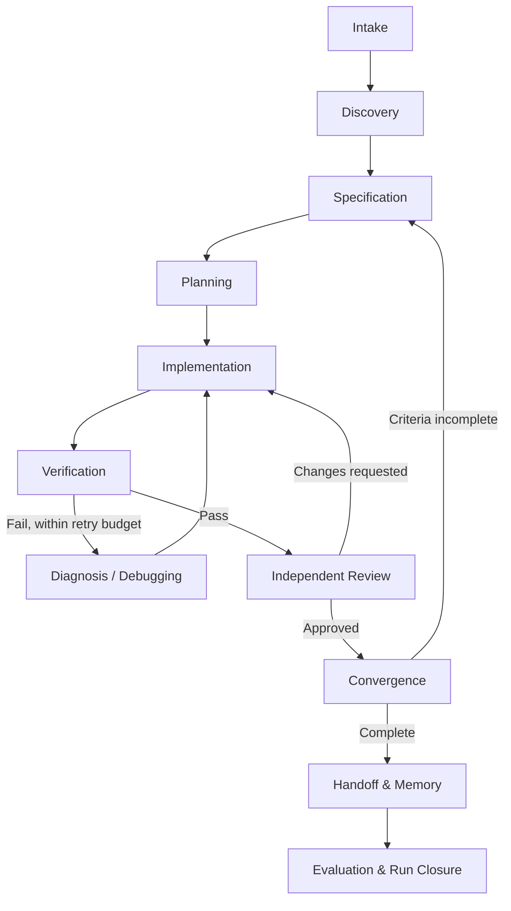

# 03 — E2E Task Execution Pipeline

## 1. Definition

The **Pipeline** is the end-to-end execution flow for a software task. It is a chain/graph of versioned stages and artifacts that preserves continuity, provenance, and traceability from user intent to verified outcome.

A pipeline is not merely a linear series of prompts. It defines:

- Stages and their dependencies.
- Inputs and output artifacts.
- Preconditions and completion gates.
- Allowed tools, skills, and model profiles.
- Failure transitions and retry limits.
- Resume and checkpoint rules.
- Human approval points.
- Trace and evaluation requirements.

## 2. Stage versus agent versus skill versus tool

- **Pipeline:** the complete workflow graph.
- **Stage:** a unit of work in that workflow, independently invocable when prerequisites exist.
- **Agent:** an LLM-driven executor/persona used by a stage when reasoning is needed.
- **Skill:** a reusable procedure or engineering discipline that can be loaded by an agent.
- **Tool:** a deterministic or external operation (read a file, run tests, query a graph, make a Git branch, etc.).
- **Artifact:** a durable result produced or consumed by a stage.

Stages and agents do not map one-to-one: a specialist may participate in multiple stages and a stage may require multiple specialists. The product nevertheless requires real specialist agents in the four pillars, selected for the task and invoked through an executor with genuine delegation. The Master coordinates but does not replace specialists with personas. Deterministic checks should not consume an LLM call unnecessarily.

## 3. Default feature-development pipeline



Learning experiments are not an ordinary stage that mutates the harness after every task. They run as a separate controlled process over accumulated evidence.

## 4. Stage definitions

### 4.1 Intake

**Purpose:** understand the requested outcome and classify the work.

**Input:** user request, repository identity, current Git state if available.

**Actions:**
- Identify task type (feature, bug, refactor, research, review, maintenance, onboarding).
- Identify expected output and scope.
- Detect ambiguity that affects design, behavior, safety, or acceptance.
- Record constraints and deadlines/budgets if supplied.
- Decide whether a short or deep pipeline is appropriate.

**Output:** `TaskEnvelope`.

**Gate:** objective and initial scope are understandable. Ask the user only for material ambiguity; do not interrogate unnecessarily.

### 4.2 Discovery

**Purpose:** understand relevant parts of the target project.

**Actions:**
- Inspect Git status and current revision.
- Read project entry documents and native agent instructions.
- Inspect top-level structure and relevant manifests.
- Follow references into related source, tests, migrations, schemas, CI and docs.
- Query structural knowledge if available and sufficiently fresh.
- Search memory for relevant decisions, failures, and handoffs.
- Identify missing or contradictory evidence.

**Output:** `DiscoveryReport` and `ContextPackage`.

**Gate:** enough evidence exists to specify the change responsibly. For a tiny change, discovery may be short.

### 4.3 Specification

**Purpose:** express the user's intent as an unambiguous, testable description.

**Actions:**
- Use a grilling/interview skill only when the request leaves material ambiguity.
- Capture functional behavior, edge cases, non-functional constraints, scope boundaries, and acceptance criteria.
- Link relevant glossary terms, ADRs, and existing system behavior.
- Distinguish new requirements from assumptions.
- Use Spec Kit ideas/artifacts where appropriate, but avoid running two competing specification systems.

**Outputs:** `Spec` and acceptance checklist.

**Gate:** each important behavior has a criterion or is explicitly marked as unresolved/assumed.

### 4.4 Planning

**Purpose:** produce an implementation strategy that respects the existing architecture.

**Actions:**
- Identify components/files likely to change and dependencies.
- Identify risks, compatibility concerns, migrations, external contracts, and rollback considerations.
- Define vertical slices/tasks and dependency edges.
- Define testing strategy before implementation.
- Decide whether subagents are beneficial.
- Decide whether worktree isolation is needed for parallel writers.
- Bind each task to relevant spec criteria.

**Output:** `ImplementationPlan` and task graph.

**Gate:** tasks are actionable, ordered, and traceable to requirements.

### 4.5 Implementation

**Purpose:** make code changes in controlled increments.

**Actions:**
- Load selected skills (TDD, domain modeling, debugging, architecture, etc.).
- Follow repository conventions rather than imposing a preferred stack.
- Make small coherent changes.
- Run targeted fast checks as useful.
- Keep a change log of important decisions and deviations.
- Do not let parallel agents edit the same working tree concurrently.

**Output:** source changes, tests, implementation notes, updated task statuses.

**Gate:** implementation is ready for verification, not merely “the agent thinks it is done.”

### 4.6 Verification

**Purpose:** gather deterministic evidence that the implementation works.

**Actions:**
- Run discovered project-native build, test, lint, type-check, format, and security checks as appropriate.
- Run relevant integration/contract tests.
- Confirm acceptance criteria with test/evidence links.
- Review Git diff for unintended changes, secrets, generated files, and scope creep.
- Report skipped checks with reasons.

**Output:** `VerificationReport`.

**Gate:** all required checks pass or an explicitly approved exception is recorded. A failed gate enters bounded diagnosis, not an infinite loop.

### 4.7 Review

**Purpose:** independently evaluate the change against the spec and project standards.

**Actions:**
- Prefer a fresh context for independent review when useful.
- Review two axes: requirement/spec fidelity and engineering standards/risk.
- Inspect correctness, security, architecture, maintainability, tests, compatibility, and operational impact.
- Findings must cite concrete files/lines or reproducible evidence.

**Output:** `ReviewReport` with severity and disposition.

**Gate:** no unresolved blocking/high-severity finding, or explicit human acceptance of remaining risk.

### 4.8 Convergence

**Purpose:** determine whether the delivered change actually satisfies the original intent.

**Actions:**
- Compare spec acceptance criteria against implementation and verification evidence.
- Check that no requirement silently disappeared during planning.
- Identify deviations, assumptions, and known limitations.
- Decide whether another bounded cycle is needed.

**Output:** `ConvergenceReport` and final task status.

**Gate:** task is `completed`, `partially_completed`, `blocked`, or `failed` with reasons. Never claim full completion on missing evidence.

### 4.9 Handoff and Memory

**Purpose:** make future sessions and other agents able to continue.

**Actions:**
- Record concise durable decisions, important failures, discoveries, unresolved questions, and next steps.
- Update project documentation/ADR only for durable, confirmed decisions.
- Create a handoff with current branch/revision, task state, changed files, checks, and outstanding work.
- Avoid storing sensitive data, secrets, or full transcripts by default.

**Output:** `Handoff` and memory references.

### 4.10 Evaluation and Run Closure

**Purpose:** close the run with an auditable account of outcome and process.

**Actions:**
- Finalize trace spans and usage/cost metadata where available.
- Score deterministic task success and acceptance criteria.
- Record intervention, retries, duration, and failure causes.
- Attach artifacts and baseline/skill/model versions.
- Feed evidence to the harness-learning queue, not directly to production skills.

**Output:** `RunReport` and optional `LearningCandidate`.

## 5. Direct stage invocation

Every stage must support direct invocation when its prerequisites are available. Examples:

- Run Discovery to understand an unfamiliar repository.
- Run Specification to turn a conversation into a testable spec.
- Run Planning against an existing spec.
- Run Verification against an existing diff or branch.
- Run Review against a completed change.

Direct invocation must declare missing prerequisites and either request them or run a bounded preparation step. It must not silently pretend that skipped stages occurred.

## 6. Resume and idempotency

Every pipeline run has a stable `run_id`. Every stage has a status (`pending`, `running`, `succeeded`, `failed`, `blocked`, `skipped`, `cancelled`). Checkpoints should record input artifact hashes/revisions and output artifact references.

On resume:

- Reuse valid completed stage outputs if their input fingerprints are unchanged.
- Re-run stages whose required inputs changed or whose outputs are stale.
- Do not repeat external side effects blindly (deployments, issue creation, destructive migrations, sending messages).
- Make stage operations idempotent where possible; otherwise use an operation key and require reconciliation.

## 7. Bounded retry and backpressure

- Configure per-stage attempt limits and overall run budgets.
- Detect repeated identical tool calls or no-progress loops.
- Require a changed hypothesis or new evidence before a repeated debugging attempt.
- Stop and produce a blocked report when the budget is exhausted.
- Allow pause/resume and human escalation.
- Context compaction must preserve references, current state, and outstanding questions.

## 8. Parallelism and subagents

Parallelize tasks with independent inputs/outputs or read-only analysis. Specialist agents are the standard means to deliver the four-pillar expertise; concurrency remains task-dependent. Use isolated worktrees/workspaces or serialize concurrent writers. The Master remains accountable for coordination, combining results, and preserving coherent state. An executor without real subagent support is unsupported rather than silently downgraded.

## 9. Example logical command surface

These are illustrative, not a requirement to expose this exact CLI:

```text
harness pipeline run feature-development
harness stage run discovery
harness stage run verification --run <run-id>
harness run resume <run-id>
harness run inspect <run-id>
```

The first onboarding flow must be initiated and driven by the AI agent. A CLI can expose later operational commands, but it must not replace AI-led onboarding or become a mandatory pre-AI scanner.
