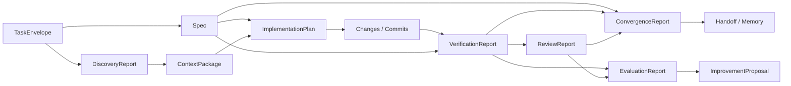

# 06 — Contracts and Durable Artifacts

## 1. Purpose

A key design principle is: **the pipeline is connected by artifacts, not only by conversation history.** Each stage consumes known inputs and produces inspectable outputs. Artifacts link to the task, run, repository revision, source evidence, and schema version.

Schemas below are conceptual starting points. The implementation agent should choose a serialization format (JSON/YAML/Markdown or combination), validate it, and version it. Keep the schema simple and migration-aware.

## 2. Required common metadata

Every machine-readable artifact should include where applicable:

```yaml
schema_version: 1
artifact_id: "stable-or-generated-id"
artifact_type: "TaskEnvelope | Spec | ..."
created_at: "ISO-8601 timestamp"
run_id: "RUN-..."
task_id: "TASK-..."
repository:
  root_id: "stable-project-identity"
  revision: "git commit or working-tree fingerprint"
producer:
  component: "stage/provider/agent"
  version: "version"
provenance:
  sources: []
  confidence: "observed | inferred | confirmed | unknown"
```

Do not record secrets or unnecessary personal data in artifacts.

## 3. Core contracts

### 3.1 TaskEnvelope

The canonical user intent and task boundary.

```yaml
task_id: TASK-042
kind: feature | bugfix | refactor | research | review | onboarding
objective: "Implement retry behavior for the orders consumer"
scope:
  in: ["orders consumer", "retry policy"]
  out: ["unrelated payment settlement refactor"]
constraints:
  - "Preserve existing event schema"
acceptance_criteria:
  - id: AC-1
    description: "Transient failures retry with configured backoff"
    verification_hint: "integration test"
  - id: AC-2
    description: "A redelivered event is not applied twice"
    verification_hint: "idempotency test"
ambiguities: []
risk: medium
```

### 3.2 DiscoveryReport

Contains relevant project facts and evidence, not a raw dump of the repository.

Suggested sections:
- Repository and revision.
- Languages/frameworks/toolchain.
- Entry points and relevant modules.
- Build/test/lint commands.
- Architecture observations.
- Data stores, APIs, events, migrations.
- Relevant files/symbols.
- Existing tests and coverage gaps.
- CI/CD and runtime constraints.
- Conflicts/unknowns.
- Provenance for each significant claim.

### 3.3 ProjectProfile

A durable project-local summary. Separate confirmed facts, observations, inferences, and unknowns. Include profile version and last verified repository revision. Do not overwrite human-authored decisions with generated summaries.

### 3.4 ContextPackage

A bounded, task-specific assembly of relevant information.

```yaml
context_package_id: CP-042
for_task: TASK-042
repository_revision: abc123
items:
  - kind: source_reference
    ref: "internal/orders/consumer.go"
    reason: "directly implements the consumer"
    freshness: current
  - kind: graph_result
    ref: "graph://OrdersConsumer/impact"
    provenance: extracted
  - kind: memory
    ref: "memory://idempotency-decision"
    reason: "relevant previous decision"
  - kind: skill
    ref: "skills/testing/tdd/SKILL.md"
    version: "pinned-version"
budget:
  estimated_tokens: 8000
excluded:
  - "unrelated frontend documentation"
```

Do not treat a token estimate as exact. The package should keep source references and include only necessary excerpts.

### 3.5 Spec

The canonical specification for the task:
- Problem statement and user outcome.
- Scope in/out.
- Functional requirements.
- Non-functional requirements.
- Domain terms.
- Edge cases and failure behavior.
- Acceptance criteria.
- Assumptions and unresolved questions.
- Related ADRs and source references.
- Status and approval state.

### 3.6 ImplementationPlan

Contains ordered tasks, dependencies, target components, risks, test strategy, migration/compatibility notes, parallelism strategy, and links to acceptance criteria.

### 3.7 StageResult

Every stage returns:

```yaml
stage_id: discovery
status: succeeded | failed | blocked | skipped | cancelled
started_at: "..."
finished_at: "..."
input_refs: []
output_refs: []
findings: []
warnings: []
next_recommendation: "..."
```

### 3.8 VerificationReport

For each check, record:
- command/check identifier;
- exact invocation or safe redacted representation;
- environment/tool version where useful;
- started/finished time and duration;
- pass/fail/skipped/not-applicable;
- exit status;
- summary and artifact/log reference;
- related acceptance criteria;
- known limitation.

Do not mark skipped checks as passed.

### 3.9 ReviewReport

Record findings by severity, file/line or evidence reference, rationale, relation to spec/standards, suggested change, and disposition. Distinguish blocking findings from suggestions.

### 3.10 ConvergenceReport

Map every acceptance criterion to evidence and status (`satisfied`, `not_satisfied`, `not_verified`, `waived`). Include deviations and final task status.

### 3.11 Handoff

Must allow another session/agent to resume:
- Task and run IDs.
- Repository revision/branch and working-tree status.
- Objective and current stage.
- What changed and where.
- What was tried and what failed.
- Decisions and rationale.
- Checks already run and results.
- Remaining work and next concrete action.
- Important context/memory references.
- Warnings and human approvals needed.

### 3.12 ExecutionTrace

Trace spans should link run, task, stage and operation. Useful attributes include agent/executor, model/provider, tool name, duration, status, retry count, token usage/cost when available, artifact references, and redaction status. Avoid storing full prompts, raw source files, credentials, or personal data by default.

### 3.13 EvaluationReport

Record task success, acceptance coverage, build/tests/lint results, regression findings, review outcome, human intervention, duration, retries, cost/usage if available, and evaluator version. Deterministic checks and semantic judgments must be identified separately.

### 3.14 ImprovementProposal

Record:
- Observed failure/success pattern.
- Supporting run IDs and sample count.
- Hypothesis about cause.
- Proposed change (skill, pipeline, policy, model profile, adapter).
- Baseline version and candidate version.
- Evaluation dataset/task set.
- Metrics and acceptance thresholds.
- Regression analysis.
- Decision: accepted/rejected/deferred.
- Human approval if required.
- Rollback reference.

## 4. Artifact relationship graph



## 5. File and storage policy

- Commit durable specifications, decisions, project profile, selected skills/overrides, pipeline config, and curated handoffs only when they are part of the project record.
- Keep local run state, large traces, caches, indexes, temporary worktrees, and raw session capture in a local/ignored location or the configured memory service.
- Avoid duplicating the same fact in multiple documents. Link to canonical sources.
- Every generated document must identify whether it is generated, human-maintained, or mixed.
- Machine-readable schemas must include `schema_version` and a documented migration policy.
