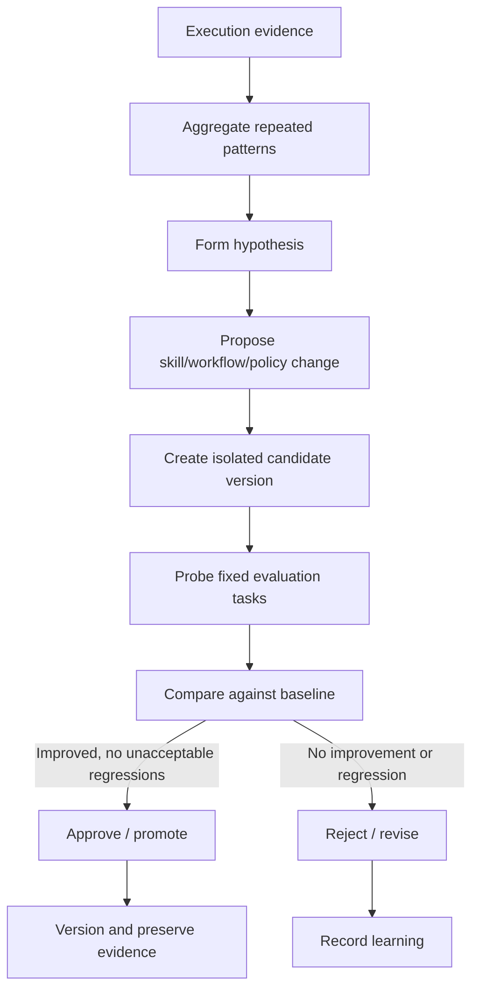

# 09 — Observability, Evaluation and Controlled Learning

## 1. Keep four responsibilities distinct

1. **Project tests:** does the changed software work?
2. **Task acceptance evaluation:** does the deliverable satisfy the user's specification?
3. **Observability:** how did the agent execute the task, and where did time/errors/cost arise?
4. **Harness improvement:** which harness strategy/skill/prompt/policy performs better under comparable conditions?

Harness² primarily informs the fourth responsibility and provides benchmark/evaluation mechanisms within its supported framework. It does not remove the need for project-native tests, task acceptance evidence, or trace instrumentation.

## 2. Observability model

Use OpenTelemetry-compatible instrumentation where supported.

Suggested trace hierarchy:

```text
pipeline.run
  ├── stage.discovery
  │    ├── tool.filesystem_search
  │    ├── knowledge.query
  │    └── memory.search
  ├── stage.specification
  │    └── model.generate
  ├── stage.planning
  │    └── model.generate
  ├── stage.implementation
  │    ├── model.generate
  │    ├── tool.file_write
  │    └── tool.terminal
  ├── stage.verification
  │    ├── tool.test
  │    └── tool.lint
  ├── stage.review
  │    └── model.review
  └── stage.convergence
```

Useful fields:
- run_id, task_id, stage_id, artifact_id.
- pipeline/version and stage version.
- executor/adapter and agent identity (non-personal stable label).
- provider/model and routing profile.
- tool name and category.
- start/end/duration and status.
- retry count and error class.
- input/output token count and cost if supplied by provider.
- links to spec, diff, test report and other artifacts.
- redaction status and sampling policy.

Do not store raw prompt/response payloads by default. If content capture is explicitly enabled for debugging, apply redaction, retention, access restrictions and user awareness.

## 3. Phoenix role

Phoenix may be configured as an optional local or hosted UI/analysis backend for traces, datasets and experiments. It is not required for the core pipeline. The harness must still operate and produce a local run report if Phoenix is unavailable.

Do not run Phoenix and Harness² as two mandatory competing optimization engines. Use Phoenix for inspection/analysis and Harness²-inspired methods for controlled harness refinement unless a clear division is documented.

## 4. Evaluation model

### 4.1 Deterministic checks

Prefer project-native objective checks:
- Build/compile.
- Unit/integration/e2e tests.
- Lint/static analysis/type checking.
- Format checks.
- Contract/schema validation.
- Migration validation.
- Security checks already used by project.
- Diff/scope checks.

Record exact commands and results. A skipped check is not a pass.

### 4.2 Acceptance criteria evaluation

Map each criterion from the Spec to evidence:
- Test ID and output.
- Source change/reference.
- Manual or reviewer evidence.
- Status: satisfied, not satisfied, not verified, waived.

Use an LLM judge only for criteria that cannot be deterministically evaluated. Record rubric, judge/model/version and confidence/limitations. Do not let a judge override failing tests or factual evidence.

### 4.3 Harness-level evaluation

Keep a small, representative set of repeatable tasks to compare changes to:
- Skills.
- Stage instructions.
- Context assembly rules.
- Model routing.
- Delegation strategy.
- Verification policy.

Use Harness²'s Propose–Probe–Compose concepts where practical. Run candidate and baseline under comparable task/model/budget/seed conditions. Record all changed variables. A candidate must not be judged better merely because the model changed or the task became easier.

A separate coding-benchmark framework is not required for initial implementation. External benchmarks such as SWE-bench Verified or Terminal-Bench may be explored later.

## 5. Useful KPIs

- Task success rate.
- Acceptance criteria completion rate.
- Required test pass rate.
- Regression rate.
- First-pass success rate.
- Human intervention rate.
- Retry/no-progress rate.
- Time per successful task.
- Cost per successful task.
- Context/token use per successful task.
- Review finding severity and escape rate.
- Resume/handoff success across sessions/executors.

Do not optimize one metric in isolation. Lower token use with lower correctness is not an improvement.

## 6. Improvement loop



### Promotion rules

- Require repeatable evidence, not one anecdotal success.
- Use the same or explicitly controlled evaluation conditions.
- Preserve baseline and candidate artifacts.
- Include regression checks.
- Require human review for changes to permissions, destructive behavior, security policy, or broad system prompts.
- Support rollback.
- Keep experiment output separate from production configuration until promoted.

## 7. Memory and learning are not the same

- ai-memory: stores project/session experiences and handoffs for future work.
- Evaluation store: records objective and semantic scores for runs.
- Harness learning: uses evidence to improve the harness itself.
- Structural graph: models code/document relationships.

Links between them are useful; merging them into one opaque store is not.
