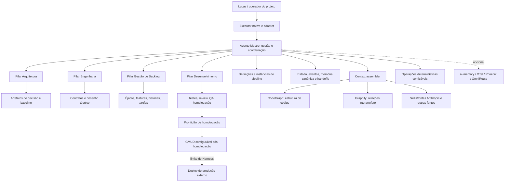

# 21 — Arquitetura integrada e plano de implementação

**Produto:** Portable Engineering Harness  
**Autoridade do produto:** Lucas de Lima  
**Estado:** plano de referência consolidado para revisão; nenhum código do Harness iniciado  
**Autoridade para decisões:** `13_LUCAS_PRODUCT_VISION_AND_DECISIONS.md`; contratos de apoio nos documentos 15–20; workspace/modes e build backlog nos documentos 23–24.

## 1. Resumo executivo

O Harness é um sistema local/projeto-centrado de coordenação de engenharia assistida por agentes. Seu operador principal é o agente mestre, cuja especialidade é gestão e coordenação. Ele compõe pipelines adaptáveis e delega a agentes especialistas reais distribuídos por quatro pilares: arquitetura, engenharia, gestão de backlog e desenvolvimento. O estado sobrevive à conversa por artefatos canônicos, versões de pipeline, eventos, evidências e handoffs. O executor fornece agentes e ferramentas; adapters declaram capacidades; helpers determinísticos validam e movimentam dados sem assumir decisões de produto.

O ciclo começa pela instalação/análise AI-first ou por uma demanda em projeto instalado. Arquitetura é analisada proporcionalmente ao problema e somente uma alternativa escolhida por Lucas vira baseline aprovada. Backlog e engenharia detalham o trabalho derivado. Desenvolvimento usa TDD conforme aplicável e entrega evidência de testes, lint/build, revisão, QA, integração/E2E e prontidão para homologação. GMUD, quando requerida, é processo de auditoria/autorização pós-homologação. Produção permanece fora do Harness.

## 2. Componentes e fronteiras

O diagrama separa responsabilidades lógicas. Um executor pode hospedar chamadas de agente e filesystem; isso não exige que o Harness crie um daemon/API central. Serviço local dedicado só deve ser introduzido se um requisito verificável precisar dele e não puder ser resolvido por recursos do host/arquivos.

## 3. Fluxo mestre de ponta a ponta

1. **Identificar projeto e modo:** `installation_analysis`, `project_request`, `resume` ou `reconcile`.
2. **Reconstruir contexto:** manifesto, estado/run aberto, baseline, backlog, eventos, handoff e evidências; detectar conflito de toggle/artefato.
3. **Caracterizar problema e proporcionalidade:** domínio, legado/novo, objetivo, restrições, riscos, critérios de aceite e incerteza; perguntar ao humano apenas o que bloqueia.
4. **Compor pipeline:** selecionar etapas, agentes e ferramentas; registrar inclusões/omissões; validar dependências, direitos, ciclo, escrita, gates e condição terminal.
5. **Arquitetura:** legado pode gerar baseline as-is com prós/contras; novo recebe alternativas adequadas; pausar até decisão de Lucas e então congelar baseline.
6. **Backlog/engenharia:** decompor escopo e criar desenho/contratos derivados da baseline; escalar incompatibilidade pela hierarquia.
7. **Desenvolvimento:** implementar unidade acordada; executar TDD, testes apropriados, lint/build, revisão independente, QA e E2E conforme contexto.
8. **Preparar homologação:** publicar relatório de evidências e artefato no ambiente escolhido, sem declarar aceite antecipado.
9. **GMUD opcional:** preparar dossiê pós-homologação se política exigir; registrar auditoria/aprovação externa comprovada.
10. **Parar e fazer handoff:** resumir resultado, estado, próxima unidade em espera, limitações e referência para continuidade. Nenhuma ação de produção.

## 4. Requisitos já confirmados versus propostas

### Confirmados por Lucas

- Quatro pilares e agentes especialistas múltiplos por pilar; mestre é gerente, não persona de todas as especialidades.
- Delegação real; ambiente sem subagentes está fora do conjunto suportado.
- Pipeline mestre, pipelines dos pilares e pipelines dinâmicas temporárias/reutilizáveis.
- Instalação/análise separada de demanda; legado as-is pode parar sem transformação.
- Baseline de arquitetura aprovada protegida; reabertura só com caso grave, evidência, solução proposta pelo arquiteto e autorização de Lucas.
- Memória canônica no projeto/artefatos da arquitetura; logs e handoffs duráveis entre sessões.
- CodeGraph e Graphify usados complementarmente; não substituir um pelo outro sem decisão explícita.
- Conhecimento público Anthropic como fonte ampla para especialistas, sem afiliação.
- Desenvolvimento completo até homologação; GMUD é auditoria/autorização pós-homologação quando aplicável; deploy de produção fica fora.
- Windows primário e Linux bem suportado; alta autonomia com controles e dependências justificadas.

### Propostas deste pacote para validar durante desenho

- Schemas mínimos e layout `.harness/` dos documentos 16–18.
- Perfil moderado e adaptativo ao risco do documento 20.
- Roteamento normal de consultas entre CodeGraph e Graphify por domínio, com avaliação comparativa em sobreposição.
- Catálogo Anthropic curado, incremental e rastreável em vez de pretensão de ingestão integral.
- Escolha de um adapter inicial depois de ensaio prático; requisitos de produto continuam multiespecialidade e extensíveis.

## 5. Lacunas críticas restantes

1. **Executor inicial e matriz real Windows/Linux:** documentação mostra possibilidades de multiagentes, mas runtime, credenciais, ambiente, custo, retomada, limites e isolamento precisam ser provados.
2. **Lista concreta e fronteira dos agentes:** definir manifests, autonomia e quais especialistas independentes são acionados por tipo de tarefa.
3. **Schemas executáveis:** YAML conceitual deve virar schema versionado com migração e validação.
4. **Combinação dos grafos:** definir consulta, duplicação, atualização, índices locais/WSL2 e medida de qualidade.
5. **Biblioteca de fontes:** escopo, periodicidade, descoberta, copyright, extração, indexação e idioma da coleção Anthropic.
6. **Segurança e privacidade por executor/cliente:** policy de rede/segredos/dependências e retenção do trace.
7. **GMUD por cliente:** template, autoridade, evidências e interface. O processo não é universalmente padronizável.
8. **Critérios mensuráveis:** qualidade por pilar, aceite E2E, reabertura arquitetural e maturidade de release.
9. **Portfólio de múltiplos sistemas:** esquema de vinculação a documentação central, ownership e resolução de conflitos.

## 6. Limites de viabilidade

Não há evidência que os quatro pilares ou as integrações citadas sejam intrinsecamente impossíveis. Há condições que tornam certas leituras tecnicamente inviáveis ou não demonstráveis:

- **“Todos os agentes em qualquer ambiente”:** inviável sem executor que ofereça delegação real. Solução: matriz de executores suportados e recusa explícita de host incompatível; não fallback de persona.
- **“Cobrir toda inteligência Anthropic publicada”:** cobertura completa e atual de tudo publicado em todo canal/idioma não pode ser garantida sem fronteira de corpus, acesso, indexação e direitos bem definidos. Solução: catálogo amplo, curado, versionado e medido, com lacunas declaradas.
- **“Resolver 95% dos problemas Microsoft/Google”:** não é critério tecnicamente verificável sem população de tarefas, distribuição, protocolo, métricas e comparação. Manter como ambição de longo prazo; validar por suites representativas e thresholds incrementais.
- **Pipeline dinâmica segura para qualquer problema:** geração aberta não permite provar qualidade/segurança apenas pelo prompt. Solução: validar grafo, authorities, capabilities, permissões, entradas/saídas, efeitos e invariantes antes de execução; risco residual documentado.
- **Portabilidade perfeita:** APIs nativas, filesystem, watcher, sandbox e permissões diferem entre Windows, Linux, WSL2 e executores. Equivalência total não deve ser prometida; compatibilidade deve ser declarada por combinação testada.
- **“Alta autonomia com zero risco”:** impossível. Autonomia, exposição de dados e efeitos colaterais exigem compromisso por classe de operação e política local.

## 7. Plano integrado de concepção e implementação

As sessões 1–6 da sequência em `14_ROTEIRO_DE_SESSOES_E_INICIO_DA_IMPLEMENTACAO.md` podem ser realizadas sem pedir que Lucas repita decisões já registradas. O documento 24 decompõe as fases abaixo em work items rastreáveis e define o estado explícito da construção versus uso em sistema-alvo:

### Fase A — Fechar contratos de concepção

1. Confirmar executor(es) candidatos com prova de subagente, sistema operacional e retomada.
2. Definir manifests versionados de agente, etapa, pipeline, run, evento, evidência e projeto.
3. Fechar matriz de autoridade: aprovações, escrita e escalonamento de arquitetura, homologação e GMUD.
4. Validar CodeGraph + Graphify num repositório sanitizado/representativo; especificar contexto/frescor.
5. Declarar política de dados, rede, dependências, logs e modelos.
6. Definir critérios E2E e conjunto sintético/anônimo que não exponha sistema privado.

### Fase B — Fundação executável integrada

1. Criar repositório/projeto do Harness, versionamento e schemas; validação do pacote documental.
2. Implementar primeiro adapter do executor comprovado e mecanismo AI-first de entrada do mestre.
3. Implementar dispatch real, retorno, estado, erro, cancelamento, retomada e matriz de capabilities.
4. Implementar manifest, event log, checkpoint, artefato/handoff e instalação/reconcile idempotentes.
5. Implementar composição/validação de pipeline, snapshots por run e execução de etapas por especialistas.
6. Demonstrar fluxo com os quatro pilares num problema sintético; não reduzir os pilares a simulação.

### Fase C — Conhecimento e qualidade

1. Adicionar providers de CodeGraph e Graphify, identificação de frescor e fallback para fonte.
2. Criar catálogo de skills/fontes com proveniência e biblioteca Anthropic inicial, sem redistribuição indevida.
3. Adicionar fluxo de contexto com busca/limite/proveniência e classificação de confiança.
4. Executar fluxo de desenvolvimento: TDD, testes, lint/build, revisão independente, QA, integração/E2E e relatório.
5. Adicionar trilhas configuráveis de homologação/GMUD e garantir parada anterior ao deploy de produção.

### Fase D — Robustez, portabilidade e release

1. Validar instalação/atualização, conflitos, recuperação e Git em Windows e Linux; WSL2 na matriz declarada.
2. Medir precisão/recall útil dos grafos; testar projeto grande e multi-repo.
3. Adicionar export de traces compatível quando configurado; não exigir Phoenix.
4. Executar suíte de aceitação em modo novo, legado/análise-only, projeto instalado com demanda e retomada.
5. Consolidar limitações, custos, dependências, versões, formatos e operação; versionar release do Harness.

Fases B–D são planejamento, não autorização para escrever código antes do gate de concepção estabelecido por Lucas no processo de trabalho. O fluxo por código deve ser integrado e incremental, preservando todos os requisitos confirmados.

## 8. Critérios de aceite do primeiro sistema integrado

| ID | Critério observável |
|---|---|
| AC-01 | Entrada identifica instalação, solicitação, retomada e conflito de toggle sem sobrescrever estado existente |
| AC-02 | Mestre delega a agentes reais distintos, captura IDs/resultados/falhas e coordena resultado |
| AC-03 | Os quatro pilares são representados por papéis e entregáveis; pipeline admite escolhas do mestre e novas composições dentro de invariantes |
| AC-04 | Instalação/análise de legado registra baseline as-is, prós/contras, evidências e handoff, e para sem demanda de mudança |
| AC-05 | Alternativas arquiteturais são proporcionais e comparáveis; aprovação cria baseline rastreável |
| AC-06 | Mudança incompatível escala pela hierarquia; reabertura exige pacote do arquiteto e decisão de Lucas |
| AC-07 | Instância dinâmica de pipeline valida dependências, gates, autoridade, saída, concorrência e parada; snapshot permite auditoria após descarte do template |
| AC-08 | Memória canônica e eventos permitem retomada sem histórico completo de conversa; dados auxiliares não substituem fonte canônica |
| AC-09 | CodeGraph e Graphify têm função complementar demonstrada, índice/versionamento e caminho de verificação da fonte |
| AC-10 | Desenvolvimento apresenta TDD/testes relevantes, lint/build, review independente, QA e E2E quando aplicável, com resultados verdadeiros |
| AC-11 | Artefato de homologação distingue “pronto”, “enviado” e “aprovado”; GMUD é gate pós-homologação configurável |
| AC-12 | Nenhuma execução automatizada do Harness faz deploy em produção |
| AC-13 | Matriz de suporte real por executor/Windows/Linux/WSL2 declara capacidades e lacunas |
| AC-14 | Fonte externa/skill/grafo tem versão/proveniência e não sobrepõe decisões de Lucas |
| AC-15 | Métricas da suíte representativa avaliam sucesso de tarefa, qualidade, falsos positivos, latência, custo, recuperação e segurança |

Threshold numérico de aceite deve ser escolhido após baseline da suíte. Não prometer um percentual global sem denominador/protocolo.

## 9. Gestão de riscos

| Risco | Resposta arquitetural |
|---|---|
| Executor perde contexto/agent | IDs duráveis, checkpoints, handoff, timeout e estado explícito |
| Agentes divergem ou escrevem ao mesmo tempo | Contexto por tarefa, contratos, scopes, worktree/serialização e síntese crítica do mestre |
| Pipeline inventada contorna gate | Validação determinística de invariantes; aprovação humana para autoridade reservada |
| Índice cria fato falso | Proveniência, hash/frescor e verificação da fonte |
| Documentação externa desatualizada/infringe termos | Registro de versão/licença, atualização e resumo/link ao invés de cópia indiscriminada |
| Prompt injection | Tratar fontes como dados não confiáveis; least privilege; ferramenta e rede controladas pelo host |
| Repetição duplica instalação ou perde estado | Idempotência, evento append-only, checkpoint e comparação de manifesto |
| Upgrade sobrescreve customização | Diff, migração explícita, backup e conflito reportado |
| Escopo cresce sem fim | Pipeline proporcional, unidade de desenvolvimento definida, critérios de conclusão e próxima unidade sob escolha do Lucas |

## 10. Decisões que ainda pedem escolha humana

Este plano não bloqueia o trabalho documental. Antes da fundação executável, Lucas deve aprovar escolhas que documentos/conhecimento não determinam: executor(es) iniciais; provedor/modelo inicial e política de dados; formato final/schema; thresholds e ambiente representativo; e se o primeiro release precisa dar suporte ao mesmo tempo a mais de um executor ou priorizar adaptação sequencial. Não são perguntas novas sobre a visão; são decisões de produto/ambiente que requerem preferência concreta.

## 11. Referências base

Ver fontes e datas em `references/SOURCE_CATALOG.md`, além dos links citados em `15_MODELO_DE_EXECUCAO_E_ADAPTERS.md` e `19_INTEGRACOES_E_ARQUITETURA_DE_CONHECIMENTO.md`. Estas fontes sustentam interfaces e padrões, não provam o Harness pronto.
